# Behavioural Design Patterns
- Algorithms and assignment of responsibilities between objects

## Usage of Chain of Resposibility (CoR)

- Use the Chain of Responsibility pattern when your program is expected to process different kinds of requests in various ways, but the exact types of requests and their sequences are unknown beforehand.

- Use the pattern when it’s essential to execute several handlers in a particular order.

- Use the CoR pattern when the set of handlers and their order are supposed to change at runtime.

[To explore the code, please look here](https://github.com/ShivamSingh226/LLD/tree/master/MyJava/src/chainOfResponsibilityDP)

## Pseudo Code( Look it again while implementing)

```js
// The handler interface declares a method for executing a
// request.
interface ComponentWithContextualHelp is
    method showHelp()


// The base class for simple components.
abstract class Component implements ComponentWithContextualHelp is
    field tooltipText: string

    // The component's container acts as the next link in the
    // chain of handlers.
    protected field container: Container

    // The component shows a tooltip if there's help text
    // assigned to it. Otherwise it forwards the call to the
    // container, if it exists.
    method showHelp() is
        if (tooltipText != null)
            // Show tooltip.
        else
            container.showHelp()


// Containers can contain both simple components and other
// containers as children. The chain relationships are
// established here. The class inherits showHelp behavior from
// its parent.
abstract class Container extends Component is
    protected field children: array of Component

    method add(child) is
        children.add(child)
        child.container = this


// Primitive components may be fine with default help
// implementation...
class Button extends Component is
    // ...

// But complex components may override the default
// implementation. If the help text can't be provided in a new
// way, the component can always call the base implementation
// (see Component class).
class Panel extends Container is
    field modalHelpText: string

    method showHelp() is
        if (modalHelpText != null)
            // Show a modal window with the help text.
        else
            super.showHelp()

// ...same as above...
class Dialog extends Container is
    field wikiPageURL: string

    method showHelp() is
        if (wikiPageURL != null)
            // Open the wiki help page.
        else
            super.showHelp()


// Client code.
class Application is
    // Every application configures the chain differently.
    method createUI() is
        dialog = new Dialog("Budget Reports")
        dialog.wikiPageURL = "http://..."
        panel = new Panel(0, 0, 400, 800)
        panel.modalHelpText = "This panel does..."
        ok = new Button(250, 760, 50, 20, "OK")
        ok.tooltipText = "This is an OK button that..."
        cancel = new Button(320, 760, 50, 20, "Cancel")
        // ...
        panel.add(ok)
        panel.add(cancel)
        dialog.add(panel)

    // Imagine what happens here.
    method onF1KeyPress() is
        component = this.getComponentAtMouseCoords()
        component.showHelp()
```

## UML CLASS DIAGRAM


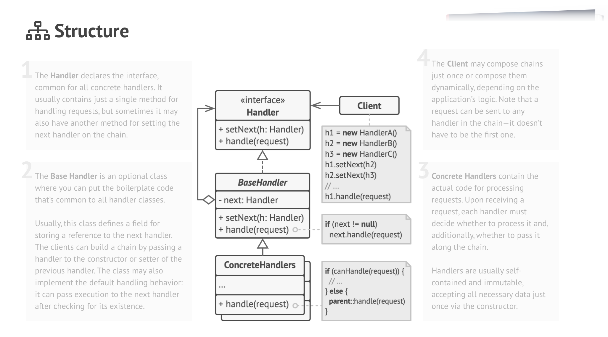

## Command Pattern

- To parameterize object with operations, queue or scheduling, reversible operations

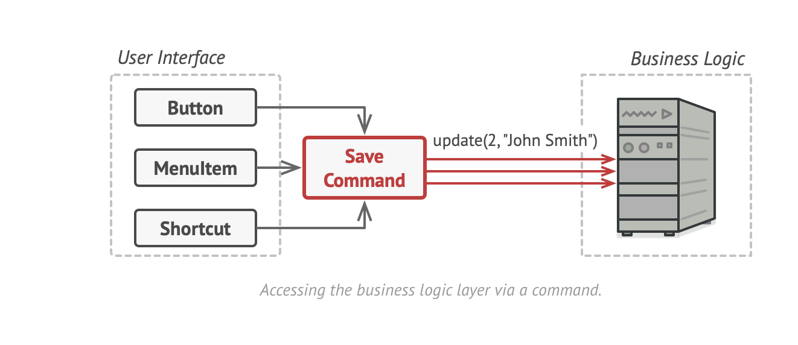

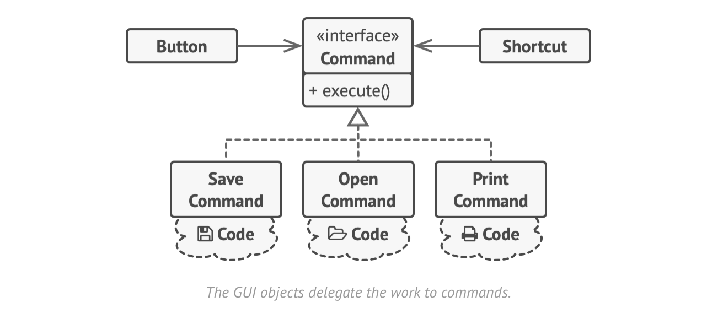


## Pseudo Code
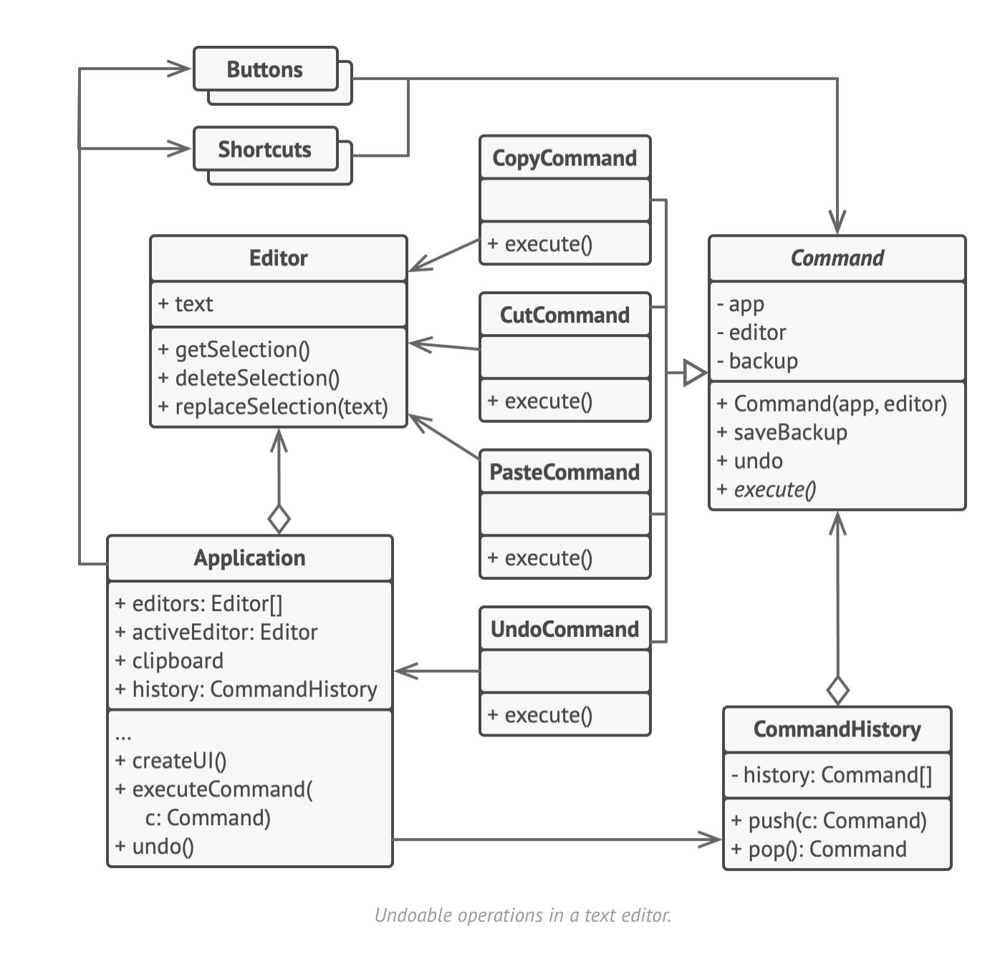
```js
// The base command class defines the common interface for all
// concrete commands.
abstract class Command is
    protected field app: Application
    protected field editor: Editor
    protected field backup: text

    constructor Command(app: Application, editor: Editor) is
        this.app = app
        this.editor = editor

    // Make a backup of the editor's state.
    method saveBackup() is
        backup = editor.text

    // Restore the editor's state.
    method undo() is
        editor.text = backup

    // The execution method is declared abstract to force all
    // concrete commands to provide their own implementations.
    // The method must return true or false depending on whether
    // the command changes the editor's state.
    abstract method execute()


// The concrete commands go here.
class CopyCommand extends Command is
    // The copy command isn't saved to the history since it
    // doesn't change the editor's state.
    method execute() is
        app.clipboard = editor.getSelection()
        return false

class CutCommand extends Command is
    // The cut command does change the editor's state, therefore
    // it must be saved to the history. And it'll be saved as
    // long as the method returns true.
    method execute() is
        saveBackup()
        app.clipboard = editor.getSelection()
        editor.deleteSelection()
        return true

class PasteCommand extends Command is
    method execute() is
        saveBackup()
        editor.replaceSelection(app.clipboard)
        return true

// The undo operation is also a command.
class UndoCommand extends Command is
    method execute() is
        app.undo()
        return false


// The global command history is just a stack.
class CommandHistory is
    private field history: array of Command

    // Last in...
    method push(c: Command) is
        // Push the command to the end of the history array.

    // ...first out
    method pop():Command is
        // Get the most recent command from the history.


// The editor class has actual text editing operations. It plays
// the role of a receiver: all commands end up delegating
// execution to the editor's methods.
class Editor is
    field text: string

    method getSelection() is
        // Return selected text.

    method deleteSelection() is
        // Delete selected text.

    method replaceSelection(text) is
        // Insert the clipboard's contents at the current
        // position.


// The application class sets up object relations. It acts as a
// sender: when something needs to be done, it creates a command
// object and executes it.
class Application is
    field clipboard: string
    field editors: array of Editors
    field activeEditor: Editor
    field history: CommandHistory

    // The code which assigns commands to UI objects may look
    // like this.
    method createUI() is
        // ...
        copy = function() { executeCommand(
            new CopyCommand(this, activeEditor)) }
        copyButton.setCommand(copy)
        shortcuts.onKeyPress("Ctrl+C", copy)

        cut = function() { executeCommand(
            new CutCommand(this, activeEditor)) }
        cutButton.setCommand(cut)
        shortcuts.onKeyPress("Ctrl+X", cut)

        paste = function() { executeCommand(
            new PasteCommand(this, activeEditor)) }
        pasteButton.setCommand(paste)
        shortcuts.onKeyPress("Ctrl+V", paste)

        undo = function() { executeCommand(
            new UndoCommand(this, activeEditor)) }
        undoButton.setCommand(undo)
        shortcuts.onKeyPress("Ctrl+Z", undo)

    // Execute a command and check whether it has to be added to
    // the history.
    method executeCommand(command) is
        if (command.execute())
            history.push(command)

    // Take the most recent command from the history and run its
    // undo method. Note that we don't know the class of that
    // command. But we don't have to, since the command knows
    // how to undo its own action.
    method undo() is
        command = history.pop()
        if (command != null)
            command.undo()
```

## UML CLASS DIAGRAM

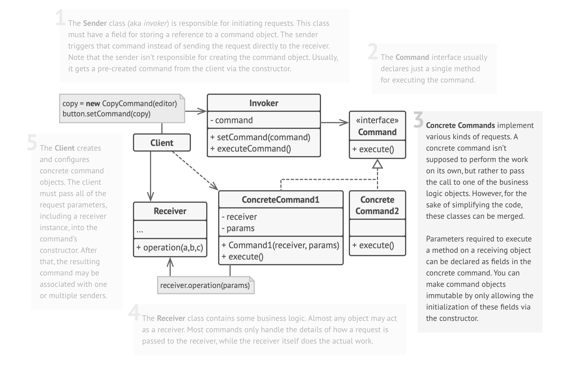

## Iterator Design Pattern

1. Converting iteration algorithm to a separate class called *Iterator* .


## Pseudo-Code

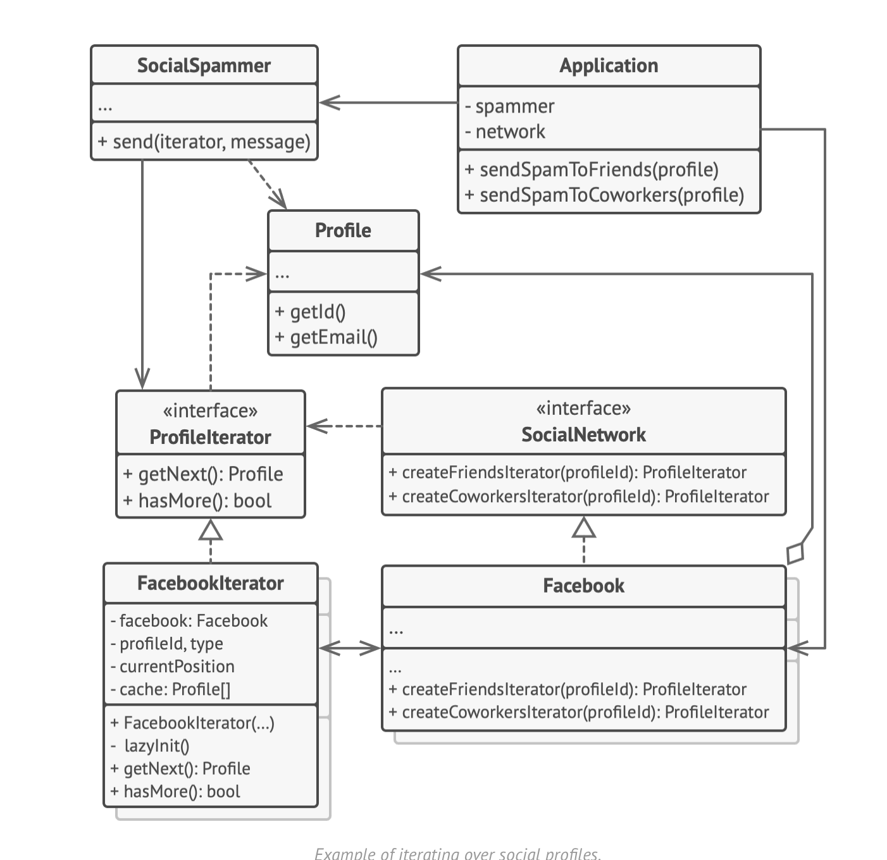
```js
// The collection interface must declare a factory method for
// producing iterators. You can declare several methods if there
// are different kinds of iteration available in your program.
interface SocialNetwork is
    method createFriendsIterator(profileId):ProfileIterator
    method createCoworkersIterator(profileId):ProfileIterator


// Each concrete collection is coupled to a set of concrete
// iterator classes it returns. But the client isn't, since the
// signature of these methods returns iterator interfaces.
class Facebook implements SocialNetwork is
    // ... The bulk of the collection's code should go here ...

    // Iterator creation code.
    method createFriendsIterator(profileId) is
        return new FacebookIterator(this, profileId, "friends")
    method createCoworkersIterator(profileId) is
        return new FacebookIterator(this, profileId, "coworkers")


// The common interface for all iterators.
interface ProfileIterator is
    method getNext():Profile
    method hasMore():bool


// The concrete iterator class.
class FacebookIterator implements ProfileIterator is
    // The iterator needs a reference to the collection that it
    // traverses.
    private field facebook: Facebook
    private field profileId, type: string

    // An iterator object traverses the collection independently
    // from other iterators. Therefore it has to store the
    // iteration state.
    private field currentPosition
    private field cache: array of Profile

    constructor FacebookIterator(facebook, profileId, type) is
        this.facebook = facebook
        this.profileId = profileId
        this.type = type

    private method lazyInit() is
        if (cache == null)
            cache = facebook.socialGraphRequest(profileId, type)

    // Each concrete iterator class has its own implementation
    // of the common iterator interface.
    method getNext() is
        if (hasMore())
            result = cache[currentPosition]
            currentPosition++
            return result

    method hasMore() is
        lazyInit()
        return currentPosition < cache.length


// Here is another useful trick: you can pass an iterator to a
// client class instead of giving it access to a whole
// collection. This way, you don't expose the collection to the
// client.
//
// And there's another benefit: you can change the way the
// client works with the collection at runtime by passing it a
// different iterator. This is possible because the client code
// isn't coupled to concrete iterator classes.
class SocialSpammer is
    method send(iterator: ProfileIterator, message: string) is
        while (iterator.hasMore())
            profile = iterator.getNext()
            System.sendEmail(profile.getEmail(), message)


// The application class configures collections and iterators
// and then passes them to the client code.
class Application is
    field network: SocialNetwork
    field spammer: SocialSpammer

    method config() is
        if working with Facebook
            this.network = new Facebook()
        if working with LinkedIn
            this.network = new LinkedIn()
        this.spammer = new SocialSpammer()

    method sendSpamToFriends(profile) is
        iterator = network.createFriendsIterator(profile.getId())
        spammer.send(iterator, "Very important message")

    method sendSpamToCoworkers(profile) is
        iterator = network.createCoworkersIterator(profile.getId())
        spammer.send(iterator, "Very important message")
```
## UML Class Diagram

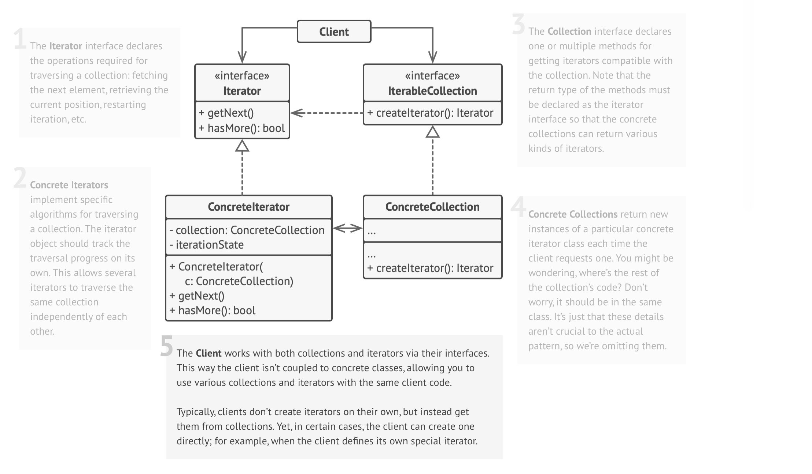

## Mediator Design Pattern

- Mediator pattern lets you encapsulate a complex web of relations between various objects inside a single mediator object.

- The fewer dependencies a class has, the easier it becomes to modify, extend or reuse that class.

## Pseudo-Code

```js
/ The mediator interface declares a method used by components
// to notify the mediator about various events. The mediator may
// react to these events and pass the execution to other
// components.
interface Mediator is
    method notify(sender: Component, event: string)


// The concrete mediator class. The intertwined web of
// connections between individual components has been untangled
// and moved into the mediator.
class AuthenticationDialog implements Mediator is
    private field title: string
    private field loginOrRegisterChkBx: Checkbox
    private field loginUsername, loginPassword: Textbox
    private field registrationUsername, registrationPassword,
                  registrationEmail: Textbox
    private field okBtn, cancelBtn: Button

    constructor AuthenticationDialog() is
        // Create all component objects by passing the current
        // mediator into their constructors to establish links.

    // When something happens with a component, it notifies the
    // mediator. Upon receiving a notification, the mediator may
    // do something on its own or pass the request to another
    // component.
    method notify(sender, event) is
        if (sender == loginOrRegisterChkBx and event == "check")
            if (loginOrRegisterChkBx.checked)
                title = "Log in"
                // 1. Show login form components.
                // 2. Hide registration form components.
            else
                title = "Register"
                // 1. Show registration form components.
                // 2. Hide login form components

        if (sender == okBtn && event == "click")
            if (loginOrRegister.checked)
                // Try to find a user using login credentials.
                if (!found)
                    // Show an error message above the login
                    // field.
            else
                // 1. Create a user account using data from the
                // registration fields.
                // 2. Log that user in.
                // ...


// Components communicate with a mediator using the mediator
// interface. Thanks to that, you can use the same components in
// other contexts by linking them with different mediator
// objects.
class Component is
    field dialog: Mediator

    constructor Component(dialog) is
        this.dialog = dialog

    method click() is
        dialog.notify(this, "click")

    method keypress() is
        dialog.notify(this, "keypress")

// Concrete components don't talk to each other. They have only
// one communication channel, which is sending notifications to
// the mediator.
class Button extends Component is
    // ...

class Textbox extends Component is
    // ...

class Checkbox extends Component is
    method check() is
        dialog.notify(this, "check")
    // ...
```

## UML CLASS DIAGRAM

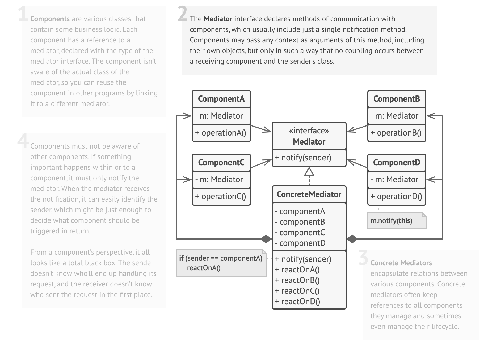

## Memento Design Pattern

Originator: The actual owner which creates the state snapshot

Memento: Special object used to store the copy of the object's state

Caretaker: Memento Storage with limited access. Only the owner can fully access the snapshot or Memento. Rest of the objects have limited access like Metadata(Creation time, etc)

- Use the pattern when direct access to the object’s fields/getters/setters violates its encapsulation.

- Prototype can be a simpler alternative to Memento. If the state object which you want to store snapshot of, is easy and straightforward without much interlinkages( **Look for more examples** in this case from GPT or Google Search)

## UML Class Diagram

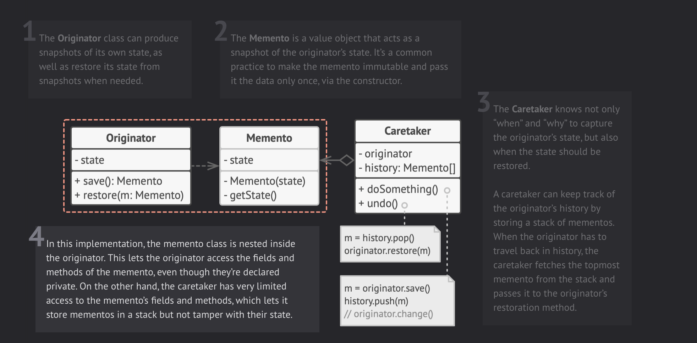

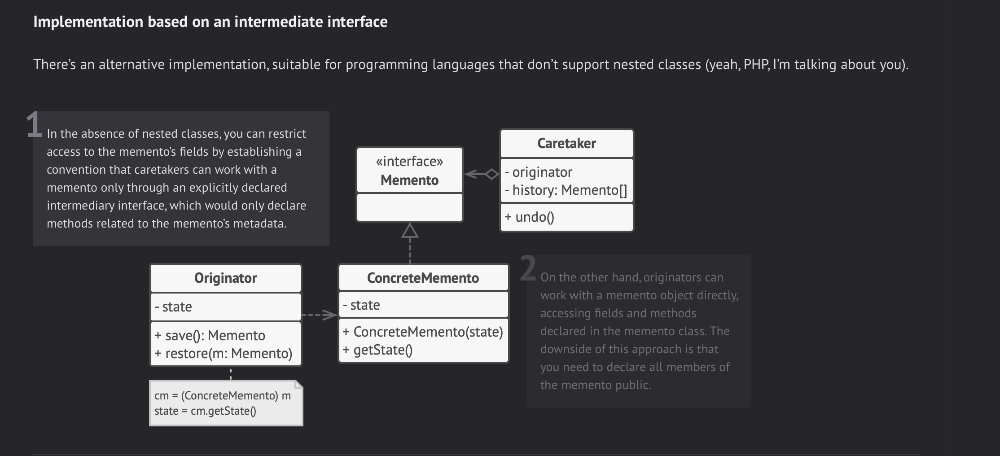

## Pseudo-Code( Command with Memento Design Pattern)

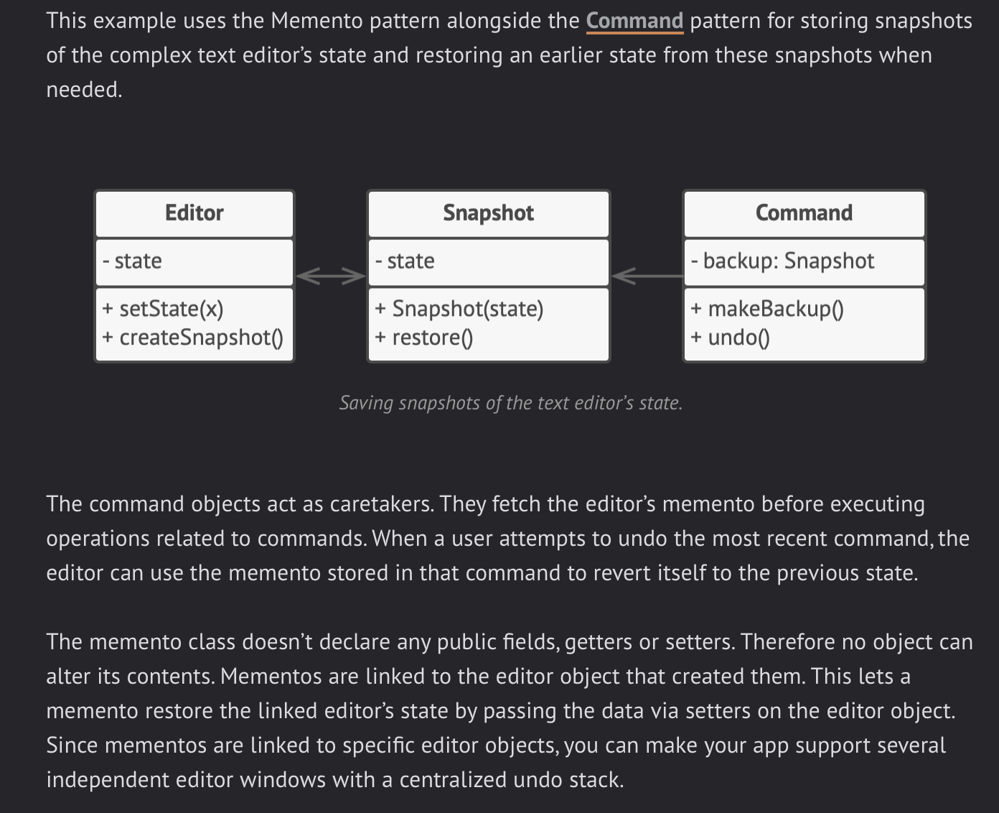

```js
// The originator holds some important data that may change over
// time. It also defines a method for saving its state inside a
// memento and another method for restoring the state from it.
class Editor is
    private field text, curX, curY, selectionWidth

    method setText(text) is
        this.text = text

    method setCursor(x, y) is
        this.curX = x
        this.curY = y

    method setSelectionWidth(width) is
        this.selectionWidth = width

    // Saves the current state inside a memento.
    method createSnapshot():Snapshot is
        // Memento is an immutable object; that's why the
        // originator passes its state to the memento's
        // constructor parameters.
        return new Snapshot(this, text, curX, curY, selectionWidth)

// The memento class stores the past state of the editor.
class Snapshot is
    private field editor: Editor
    private field text, curX, curY, selectionWidth

    constructor Snapshot(editor, text, curX, curY, selectionWidth) is
        this.editor = editor
        this.text = text
        this.curX = x
        this.curY = y
        this.selectionWidth = selectionWidth

    // At some point, a previous state of the editor can be
    // restored using a memento object.
    method restore() is
        editor.setText(text)
        editor.setCursor(curX, curY)
        editor.setSelectionWidth(selectionWidth)

// A command object can act as a caretaker. In that case, the
// command gets a memento just before it changes the
// originator's state. When undo is requested, it restores the
// originator's state from a memento.
class Command is
    private field backup: Snapshot

    method makeBackup() is
        backup = editor.createSnapshot()

    method undo() is
        if (backup != null)
            backup.restore()
    // ...
```


## Observer Design Pattern

*Subject*: An object having interesting property, since it interacts with other objects,*Subscriber* about the changes in its state, it is called *Publisher*.

[To explore code related to Observer](https://github.com/ShivamSingh226/LLD/tree/master/MyJava/src/observer)

## Pseudo-Code

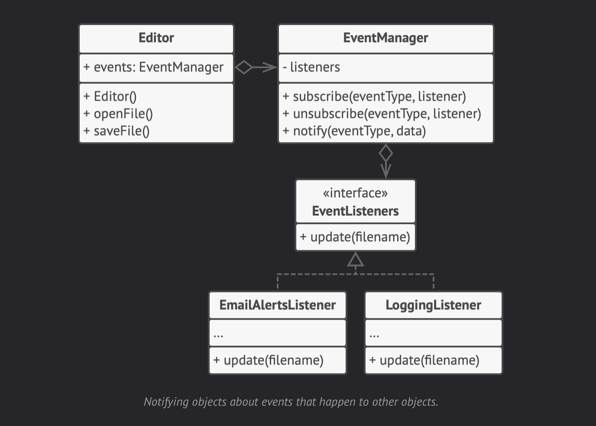

```js
// The base publisher class includes subscription management
// code and notification methods.
class EventManager is
    private field listeners: hash map of event types and listeners

    method subscribe(eventType, listener) is
        listeners.add(eventType, listener)

    method unsubscribe(eventType, listener) is
        listeners.remove(eventType, listener)

    method notify(eventType, data) is
        foreach (listener in listeners.of(eventType)) do
            listener.update(data)

// The concrete publisher contains real business logic that's
// interesting for some subscribers. We could derive this class
// from the base publisher, but that isn't always possible in
// real life because the concrete publisher might already be a
// subclass. In this case, you can patch the subscription logic
// in with composition, as we did here.
class Editor is
    public field events: EventManager
    private field file: File

    constructor Editor() is
        events = new EventManager()

    // Methods of business logic can notify subscribers about
    // changes.
    method openFile(path) is
        this.file = new File(path)
        events.notify("open", file.name)

    method saveFile() is
        file.write()
        events.notify("save", file.name)

    // ...


// Here's the subscriber interface. If your programming language
// supports functional types, you can replace the whole
// subscriber hierarchy with a set of functions.
interface EventListener is
    method update(filename)

// Concrete subscribers react to updates issued by the publisher
// they are attached to.
class LoggingListener implements EventListener is
    private field log: File
    private field message: string

    constructor LoggingListener(log_filename, message) is
        this.log = new File(log_filename)
        this.message = message

    method update(filename) is
        log.write(replace('%s',filename,message))

class EmailAlertsListener implements EventListener is
    private field email: string
    private field message: string

    constructor EmailAlertsListener(email, message) is
        this.email = email
        this.message = message

    method update(filename) is
        system.email(email, replace('%s',filename,message))


// An application can configure publishers and subscribers at
// runtime.
class Application is
    method config() is
        editor = new Editor()

        logger = new LoggingListener(
            "/path/to/log.txt",
            "Someone has opened the file: %s")
        editor.events.subscribe("open", logger)

        emailAlerts = new EmailAlertsListener(
            "admin@example.com",
            "Someone has changed the file: %s")
        editor.events.subscribe("save", emailAlerts)
```

| Relationship | How its Coded | Lifecycle Ownership |
|---|---|---|
|**Composition**|`this.events=new EventManager()` inside `Editor` Constructor|Editor creates and owns EventManager|
|**Aggregation**|`EventManager` is created outside and passed into `Editor(events)`|`EventManager` exists independently and can outlive `Editor` or be shared with other objects |

### Aggregation
```js
class EventManager {
    public void notify(String event) {
        System.out.println("Event triggered: " + event);
    }
}

class Editor {
    private EventManager events; // Reference stored as a field

    // Aggregation: receives an already-existing object
    public Editor(EventManager events) {
        this.events = events;
    }
}

public class Main {
    public static void main(String[] args) {
        // 1. Created independently outside Editor
        EventManager sharedEvents = new EventManager();

        // 2. Passed into Editor
        Editor editor = new Editor(sharedEvents);

        // 3. Even if editor is destroyed, sharedEvents still lives
        editor = null;
        sharedEvents.notify("Still alive!");
    }
}
```

### Composition

```js
class EventManager {
    public void subscribe(String eventType) {
        System.out.println("Subscribed to: " + eventType);
    }

    public void notify(String eventType) {
        System.out.println("Event triggered: " + eventType);
    }
}

class Editor {
    // 1. private final: hidden from outside and cannot be reassigned
    private final EventManager events;

    public Editor() {
        // 2. Instantiated INSIDE the parent class
        this.events = new EventManager();
    }

    // 3. Delegate behavior instead of exposing the EventManager object directly
    public void subscribe(String eventType) {
        this.events.subscribe(eventType);
    }

    public void openFile(String path) {
        this.events.notify("open");
    }
}

public class Main {
    public static void main(String[] args) {
        Editor editor = new Editor();
        editor.subscribe("open");
        editor.openFile("test.txt");

        // When editor is destroyed, its EventManager is garbage-collected with it
        editor = null;
    }
}
```

## UML CLASS DIAGRAM

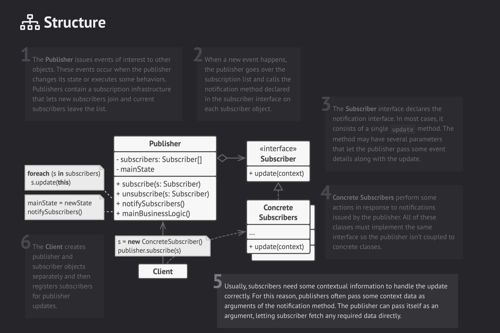

## State Design Pattern

- Switching rules for changing states: *Transition*

- Reference to one of the state objects would be stored in the object: *Context*

- The states may be aware of each other as they make transition, while such is not the case in *Strategy* DP pattern

## Pseudo-Code

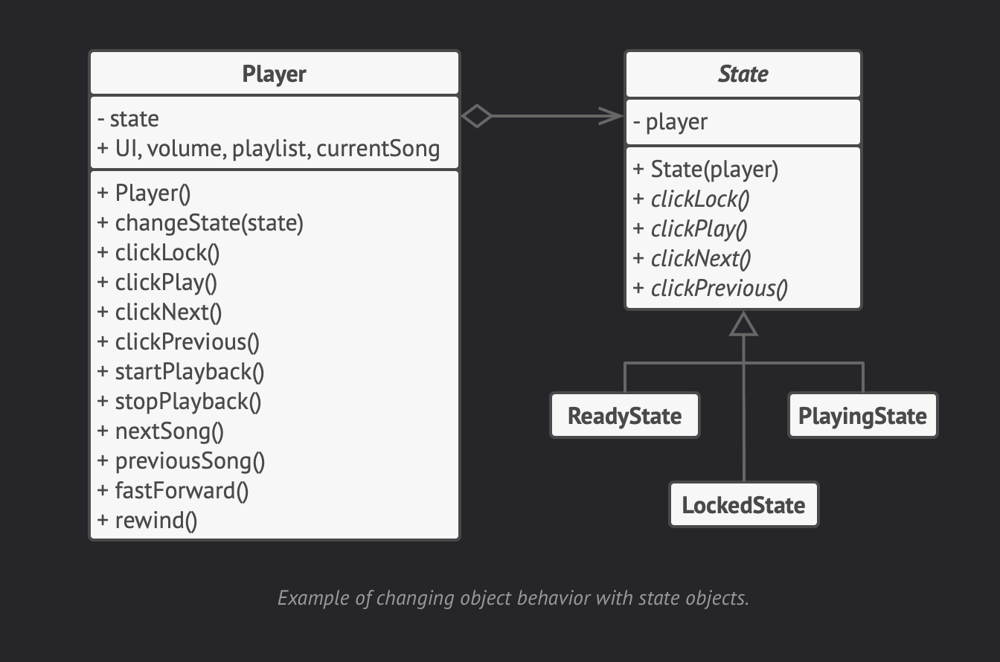

```js
// The AudioPlayer class acts as a context. It also maintains a
// reference to an instance of one of the state classes that
// represents the current state of the audio player.
class AudioPlayer is
    field state: State
    field UI, volume, playlist, currentSong

    constructor AudioPlayer() is
        this.state = new ReadyState(this)

        // Context delegates handling user input to a state
        // object. Naturally, the outcome depends on what state
        // is currently active, since each state can handle the
        // input differently.
        UI = new UserInterface()
        UI.lockButton.onClick(this.clickLock)
        UI.playButton.onClick(this.clickPlay)
        UI.nextButton.onClick(this.clickNext)
        UI.prevButton.onClick(this.clickPrevious)

    // Other objects must be able to switch the audio player's
    // active state.
    method changeState(state: State) is
        this.state = state

    // UI methods delegate execution to the active state.
    method clickLock() is
        state.clickLock()
    method clickPlay() is
        state.clickPlay()
    method clickNext() is
        state.clickNext()
    method clickPrevious() is
        state.clickPrevious()

    // A state may call some service methods on the context.
    method startPlayback() is
        // ...
    method stopPlayback() is
        // ...
    method nextSong() is
        // ...
    method previousSong() is
        // ...
    method fastForward(time) is
        // ...
    method rewind(time) is
        // ...


// The base state class declares methods that all concrete
// states should implement and also provides a backreference to
// the context object associated with the state. States can use
// the backreference to transition the context to another state.
abstract class State is
    protected field player: AudioPlayer

    // Context passes itself through the state constructor. This
    // may help a state fetch some useful context data if it's
    // needed.
    constructor State(player) is
        this.player = player

    abstract method clickLock()
    abstract method clickPlay()
    abstract method clickNext()
    abstract method clickPrevious()


// Concrete states implement various behaviors associated with a
// state of the context.
class LockedState extends State is

    // When you unlock a locked player, it may assume one of two
    // states.
    method clickLock() is
        if (player.playing)
            player.changeState(new PlayingState(player))
        else
            player.changeState(new ReadyState(player))

    method clickPlay() is
        // Locked, so do nothing.

    method clickNext() is
        // Locked, so do nothing.

    method clickPrevious() is
        // Locked, so do nothing.


// They can also trigger state transitions in the context.
class ReadyState extends State is
    method clickLock() is
        player.changeState(new LockedState(player))

    method clickPlay() is
        player.startPlayback()
        player.changeState(new PlayingState(player))

    method clickNext() is
        player.nextSong()

    method clickPrevious() is
        player.previousSong()


class PlayingState extends State is
    method clickLock() is
        player.changeState(new LockedState(player))

    method clickPlay() is
        player.stopPlayback()
        player.changeState(new ReadyState(player))

    method clickNext() is
        if (event.doubleclick)
            player.nextSong()
        else
            player.fastForward(5)

    method clickPrevious() is
        if (event.doubleclick)
            player.previous()
        else
            player.rewind(5)
```

## Class UML Diagram

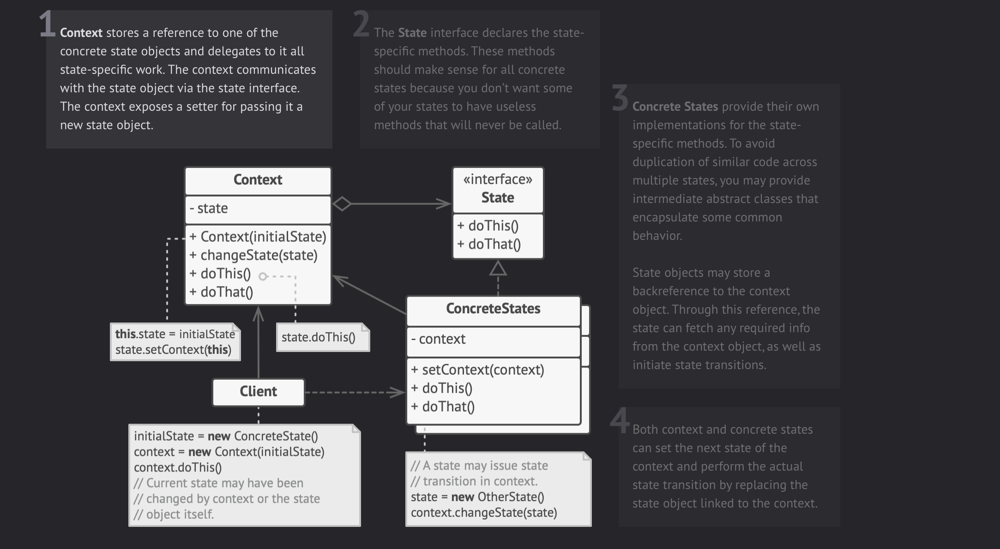

## Strategy DP

Grouping of specific algorithms into *Strategy* to which *Context* stores the reference.

## Pseudo-code

```js
// The strategy interface declares operations common to all
// supported versions of some algorithm. The context uses this
// interface to call the algorithm defined by the concrete
// strategies.
interface Strategy is
    method execute(a, b)

// Concrete strategies implement the algorithm while following
// the base strategy interface. The interface makes them
// interchangeable in the context.
class ConcreteStrategyAdd implements Strategy is
    method execute(a, b) is
        return a + b

class ConcreteStrategySubtract implements Strategy is
    method execute(a, b) is
        return a - b

class ConcreteStrategyMultiply implements Strategy is
    method execute(a, b) is
        return a * b

// The context defines the interface of interest to clients.
class Context is
    // The context maintains a reference to one of the strategy
    // objects. The context doesn't know the concrete class of a
    // strategy. It should work with all strategies via the
    // strategy interface.
    private strategy: Strategy

    // Usually the context accepts a strategy through the
    // constructor, and also provides a setter so that the
    // strategy can be switched at runtime.
    method setStrategy(Strategy strategy) is
        this.strategy = strategy

    // The context delegates some work to the strategy object
    // instead of implementing multiple versions of the
    // algorithm on its own.
    method executeStrategy(int a, int b) is
        return strategy.execute(a, b)


// The client code picks a concrete strategy and passes it to
// the context. The client should be aware of the differences
// between strategies in order to make the right choice.
class ExampleApplication is
    method main() is
        Create context object.

        Read first number.
        Read last number.
        Read the desired action from user input.

        if (action == addition) then
            context.setStrategy(new ConcreteStrategyAdd())

        if (action == subtraction) then
            context.setStrategy(new ConcreteStrategySubtract())

        if (action == multiplication) then
            context.setStrategy(new ConcreteStrategyMultiply())

        result = context.executeStrategy(First number, Second number)

        Print result.
```

## UML Class Diagram

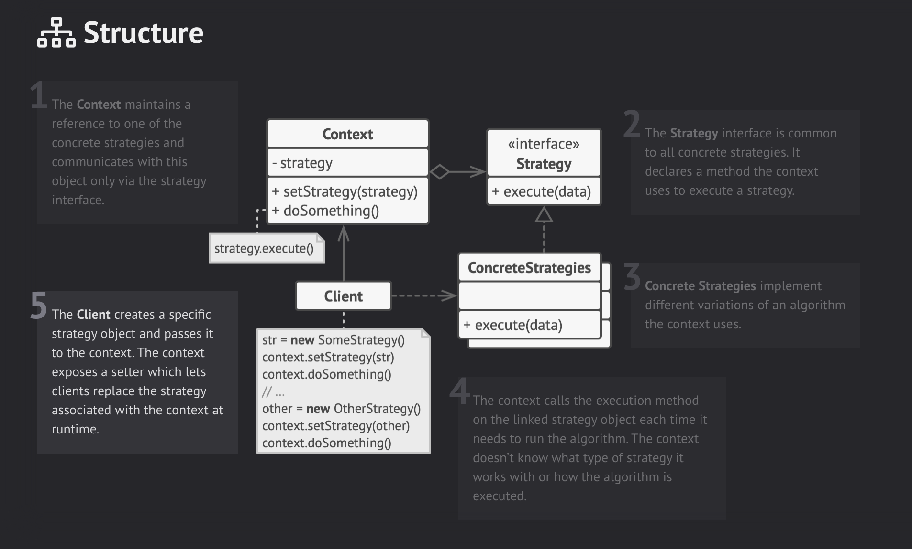