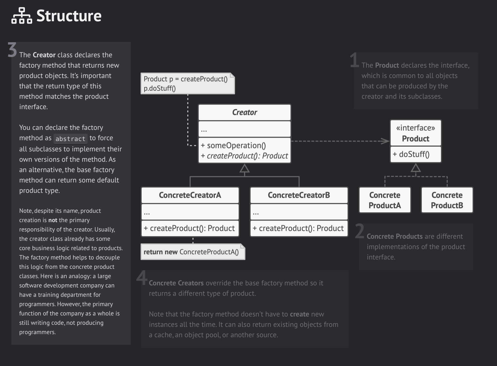
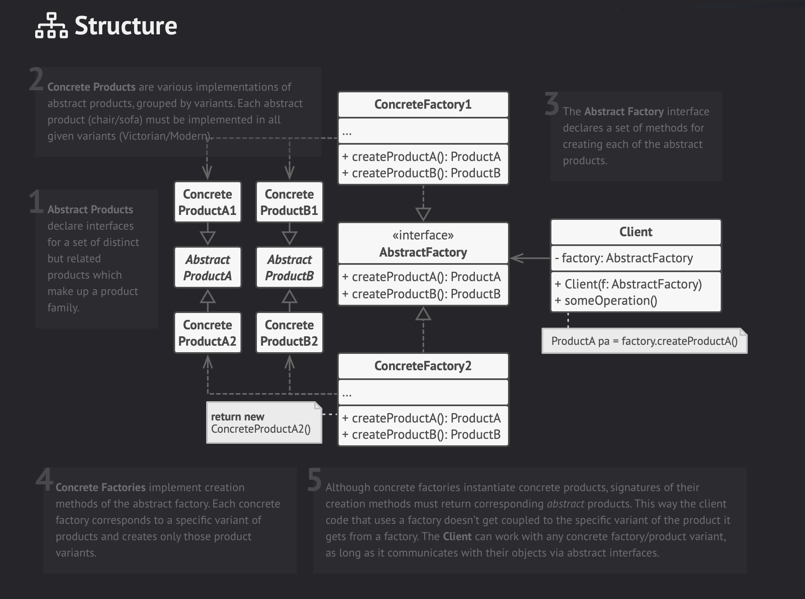
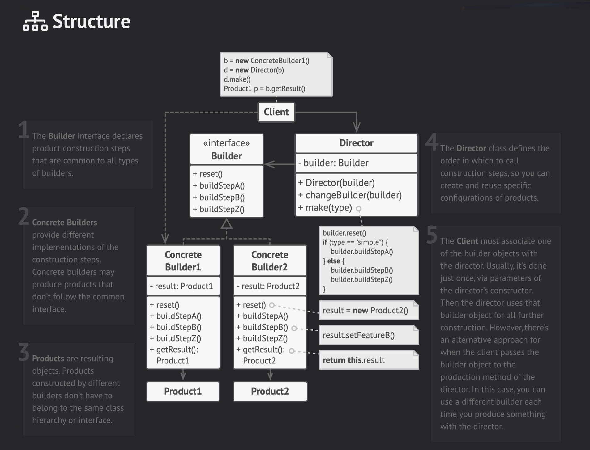
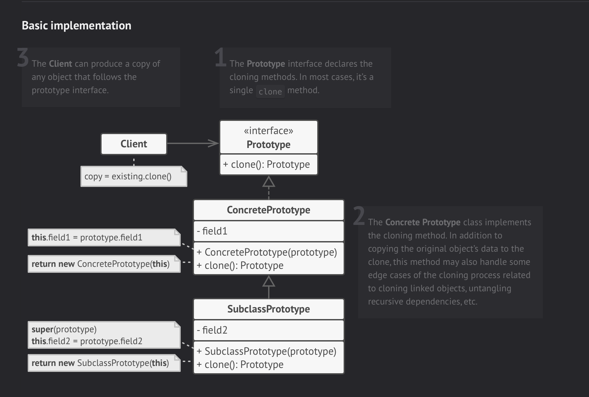
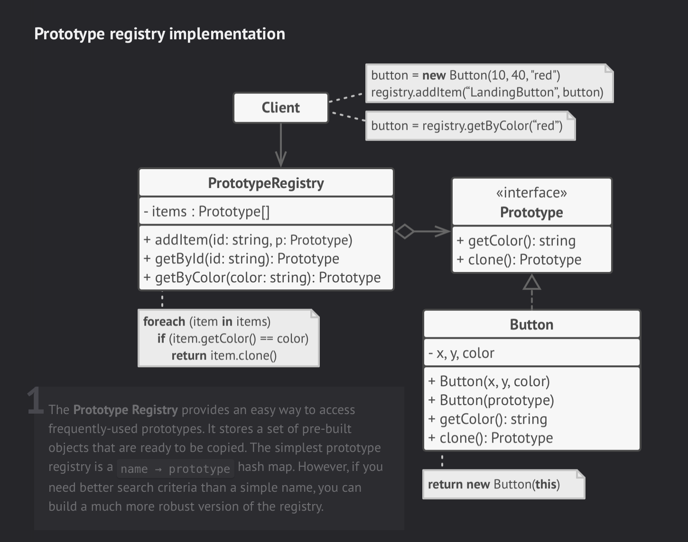
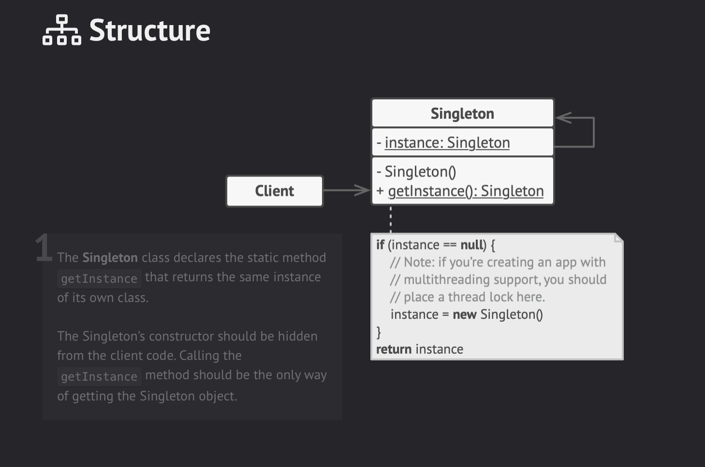

# Creational Design Pattern

## Usage of Factory Pattern

1. Suppose we write an app using Open Source `UIFramework`. But, the framework provides only **Square buttons**. And we want to have our CustomUI `RoundButton`. 

2. So, how do we tell `UIFramework` to use our UI? We override `UIFramework` with `UIWithRoundButtons` and override method `createButton`.

3. `Button` interface is extended with `RoundButton` class

[Explore the code for more examples ](https://github.com/ShivamSingh226/LLD/tree/master/MyJava/src/factoryDP)

## **UML DIAGRAM**


## Usage of Abstract Factory

1. Lets you create families of related objects without specifying their concrete class.

2. If the client is only exposed to the abstract interfaces, what creates the actual factory objects? Usually, the application creates a concrete factory object at the initialization stage. Just before that, the app must select the factory type depending on the configuration or the environment settings.

3. Use the Abstract Factory when your code needs to work with various families of related products, but you don’t want it to depend on the concrete classes of those products—they might be unknown beforehand or you simply want to allow for future extensibility.

4. Consider implementing the Abstract Factory when you have a class with a set of **<ins>Factory Methods</ins>** that blur its primary responsibility.


[ For more example, Read Code](https://github.com/ShivamSingh226/LLD/tree/master/MyJava/src/abstractFactoryDP)

## **UML DIAGRAM**



## Usage of Builder Pattern

1. Construction of Complex Objects Step-By-Step using **Builder**. Also, to get rid of **Telescoping Constructor** .

2. **Director** class defines the order in which to execute the building steps, while the **Builder** provides the implementation for those steps.

**Importante Note**: While returning finished objects after instantiating builder using Director:

- We can’t place a method for fetching results in the director without coupling the director to concrete product classes. Hence, we obtain the result of the construction from the builder which performed the job.

[ For Code illustration ](https://github.com/ShivamSingh226/LLD/tree/master/MyJava/src/builder)

## **UML DIAGRAM**



## Usage of Prototype Pattern

- Copies existing objects without depending upon their classes

- An object that supports cloning is called *Prototype* (A precursor cell during *mitosis*)

- To save copies of <ins> Comands </ins> in history

- Isn't based on inheritance, complicated initialization unlike <ins>**Factory method**</ins> requiring inheritance but no initialization.

```js
// Base prototype.
abstract class Shape is
    field X: int
    field Y: int
    field color: string

    // A regular constructor.
    constructor Shape() is
        // ...

    // The prototype constructor. A fresh object is initialized
    // with values from the existing object.
    constructor Shape(source: Shape) is
        this()
        this.X = source.X
        this.Y = source.Y
        this.color = source.color

    // The clone operation returns one of the Shape subclasses.
    abstract method clone():Shape


// Concrete prototype. The cloning method creates a new object
// in one go by calling the constructor of the current class and
// passing the current object as the constructor's argument.
// Performing all the actual copying in the constructor helps to
// keep the result consistent: the constructor will not return a
// result until the new object is fully built; thus, no object
// can have a reference to a partially-built clone.
class Rectangle extends Shape is
    field width: int
    field height: int

    constructor Rectangle(source: Rectangle) is
        // A parent constructor call is needed to copy private
        // fields defined in the parent class.
        super(source)
        this.width = source.width
        this.height = source.height

    method clone():Shape is
        return new Rectangle(this)


class Circle extends Shape is
    field radius: int

    constructor Circle(source: Circle) is
        super(source)
        this.radius = source.radius

    method clone():Shape is
        return new Circle(this)


// Somewhere in the client code.
class Application is
    field shapes: array of Shape

    constructor Application() is
        Circle circle = new Circle()
        circle.X = 10
        circle.Y = 10
        circle.radius = 20
        shapes.add(circle)

        Circle anotherCircle = circle.clone()
        shapes.add(anotherCircle)
        // The `anotherCircle` variable contains an exact copy
        // of the `circle` object.

        Rectangle rectangle = new Rectangle()
        rectangle.width = 10
        rectangle.height = 20
        shapes.add(rectangle)

    method businessLogic() is
        // Prototype rocks because it lets you produce a copy of
        // an object without knowing anything about its type.
        Array shapesCopy = new Array of Shapes.

        // For instance, we don't know the exact elements in the
        // shapes array. All we know is that they are all
        // shapes. But thanks to polymorphism, when we call the
        // `clone` method on a shape the program checks its real
        // class and runs the appropriate clone method defined
        // in that class. That's why we get proper clones
        // instead of a set of simple Shape objects.
        foreach (s in shapes) do
            shapesCopy.add(s.clone())

        // The `shapesCopy` array contains exact copies of the
        // `shape` array's children.
```

## **UML DIAGRAM**





## Usage of Singleton Pattern

- **Abstract Factories, Builders and Prototypes** can all be implemented as <ins>Singletons.</ins>
- Making sure that a class has only one instance while providing a global access point to this instance.(Making Constructor as **private**)
- Static creation method which acts as constructor. This calls constructor under head and returns object and saves it in a static field

```js
// The Database class defines the `getInstance` method that lets
// clients access the same instance of a database connection
// throughout the program.
class Database is
    // The field for storing the singleton instance should be
    // declared static.
    private static field instance: Database

    // The singleton's constructor should always be private to
    // prevent direct construction calls with the `new`
    // operator.
    private constructor Database() is
        // Some initialization code, such as the actual
        // connection to a database server.
        // ...

    // The static method that controls access to the singleton
    // instance.
    public static method getInstance() is
        if (Database.instance == null) then
            acquireThreadLock() and then
                // Ensure that the instance hasn't yet been
                // initialized by another thread while this one
                // has been waiting for the lock's release.
                if (Database.instance == null) then
                    Database.instance = new Database()
        return Database.instance

    // Finally, any singleton should define some business logic
    // which can be executed on its instance.
    public method query(sql) is
        // For instance, all database queries of an app go
        // through this method. Therefore, you can place
        // throttling or caching logic here.
        // ...

class Application is
    method main() is
        Database foo = Database.getInstance()
        foo.query("SELECT ...")
        // ...
        Database bar = Database.getInstance()
        bar.query("SELECT ...")
        // The variable `bar` will contain the same object as
        // the variable `foo`.
```

## UML Diagram


