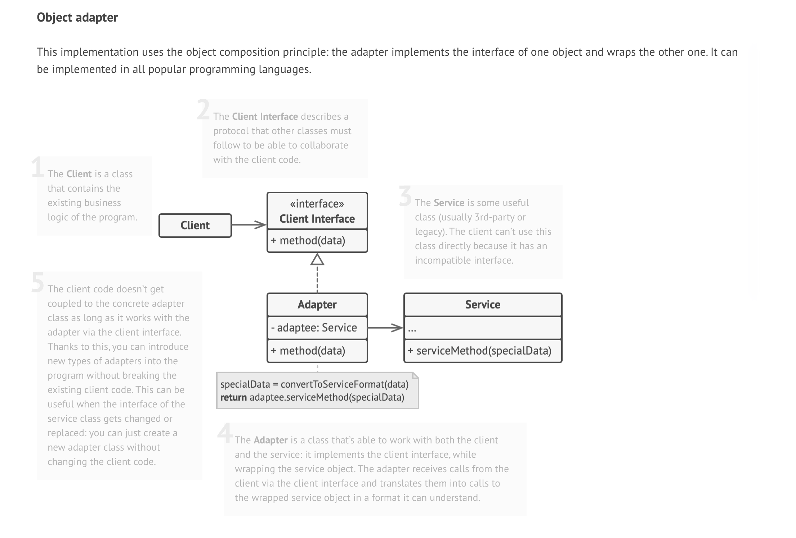
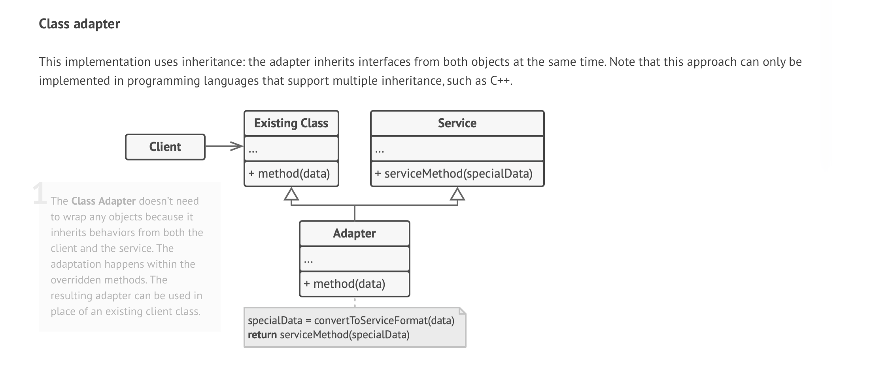
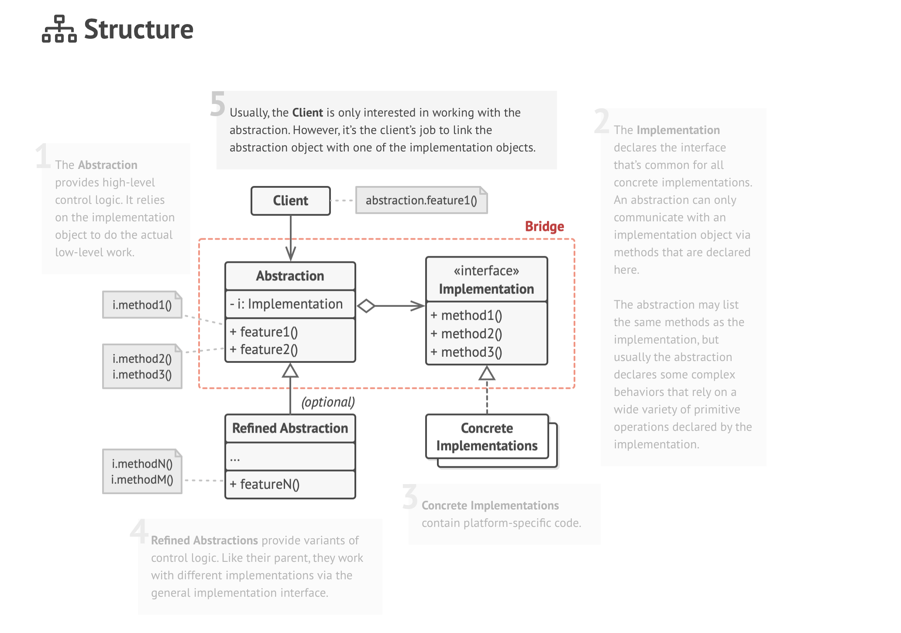
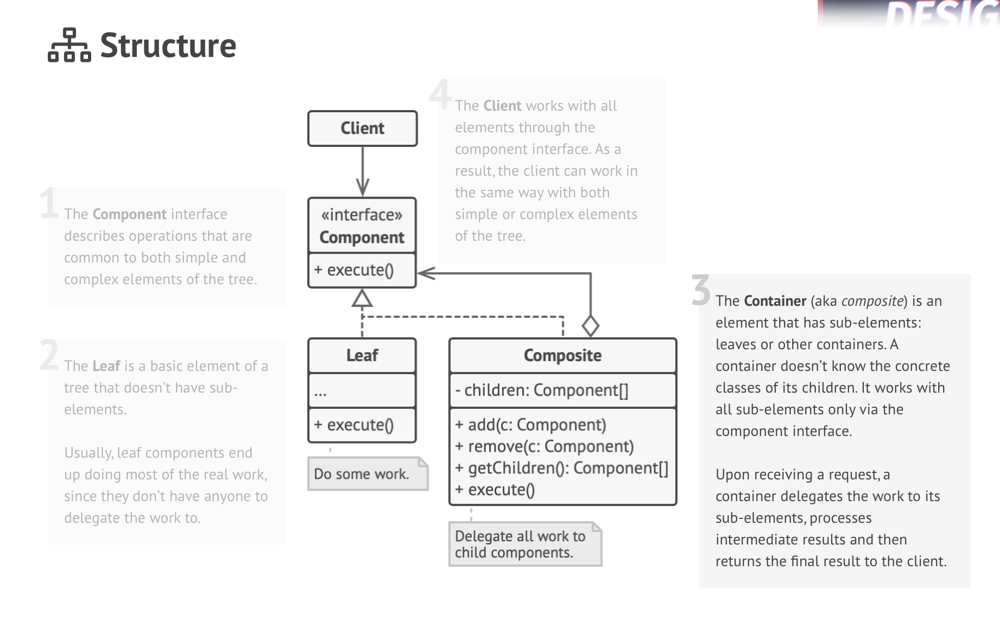
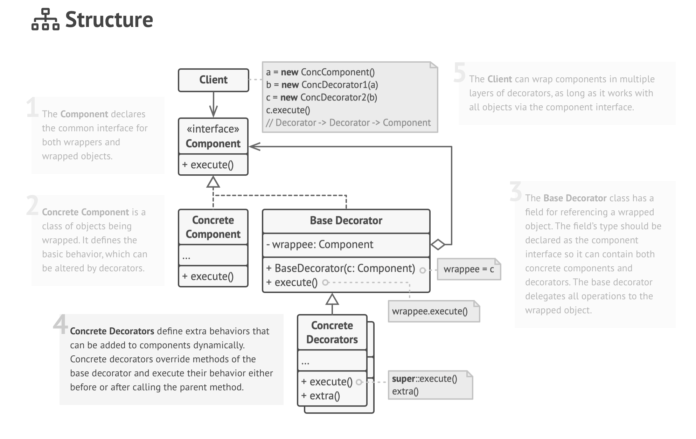
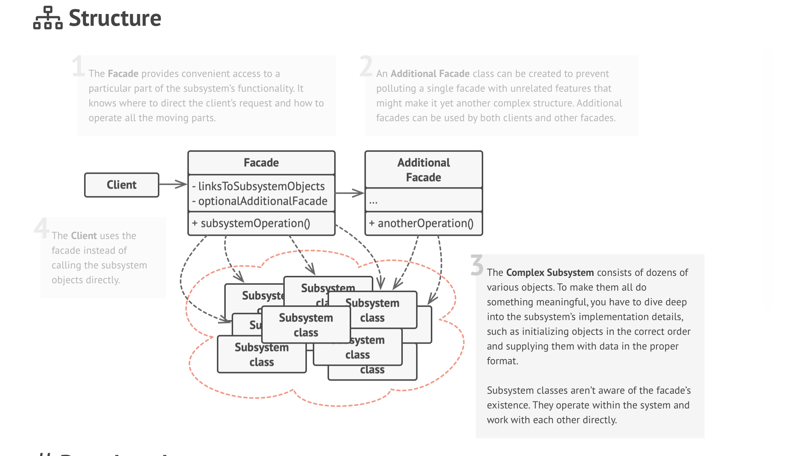
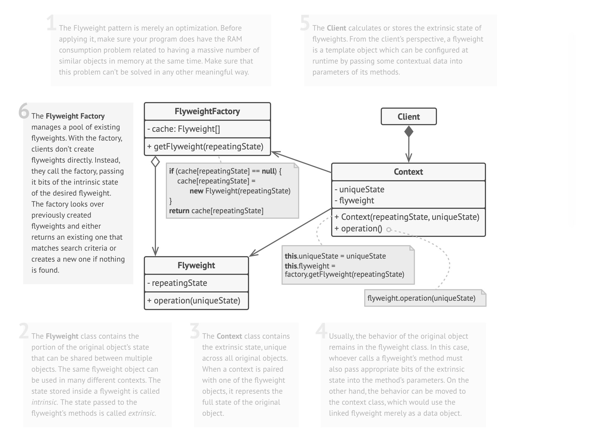
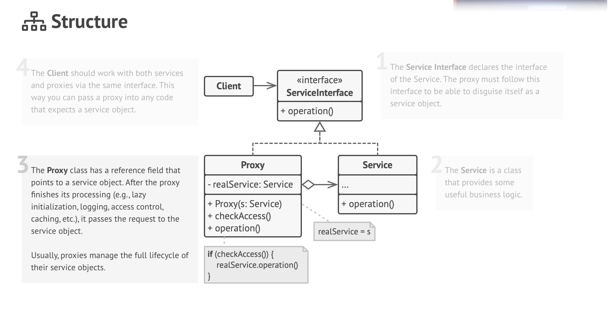

# Structural Design Pattern

## Adapter Pattern

- Conversion and wraps the incompatible object to effectively communicate with the client

- In Adapter design pattern, the **adaptee** is an existing class with an incompatible interface, and the **adapter** is a translator class that makes the adaptee work with the interface a client expects

- <ins>**Bridge, State, Strategy (and to some degree Adapter)**</ins> have very similar structures. Indeed, all of these patterns are based on composition, which is delegating work to other objects.
- **Decorator** supports *recursive composition* (i.e interface gets reused or extended)

- With **Adapter** you access an existing object via different interface. With **Proxy**, the interface stays the same. With **Decorator** you access the object via an enhanced interface.


[ To explore more, browse the code ](https://github.com/ShivamSingh226/LLD/tree/master/MyJava/src/adapterDP)

## UML Diagram



- Important Note: Class Adapter are not supported in Java(**Java doesn't support multiple inheritance**)



## Bridge Pattern

- Evolving Abstraction and Implementation independently. 

- *Abstraction* (also called **interface**) is a high-level control layer for some entity. It should delegate the work to the *implementation layer* (also called **platform**). 
- For example: GUI is an Abstraction and API or Operating System level code can be called implementation

## Pseudo-Code

```js
// The "abstraction" defines the interface for the "control"
// part of the two class hierarchies. It maintains a reference
// to an object of the "implementation" hierarchy and delegates
// all of the real work to this object.
class RemoteControl is
    protected field device: Device
    constructor RemoteControl(device: Device) is
        this.device = device
    method togglePower() is
        if (device.isEnabled()) then
            device.disable()
        else
            device.enable()
    method volumeDown() is
        device.setVolume(device.getVolume() - 10)
    method volumeUp() is
        device.setVolume(device.getVolume() + 10)
    method channelDown() is
        device.setChannel(device.getChannel() - 1)
    method channelUp() is
        device.setChannel(device.getChannel() + 1)


// You can extend classes from the abstraction hierarchy
// independently from device classes.
class AdvancedRemoteControl extends RemoteControl is
    method mute() is
        device.setVolume(0)


// The "implementation" interface declares methods common to all
// concrete implementation classes. It doesn't have to match the
// abstraction's interface. In fact, the two interfaces can be
// entirely different. Typically the implementation interface
// provides only primitive operations, while the abstraction
// defines higher-level operations based on those primitives.
interface Device is
    method isEnabled()
    method enable()
    method disable()
    method getVolume()
    method setVolume(percent)
    method getChannel()
    method setChannel(channel)


// All devices follow the same interface.
class Tv implements Device is
    // ...

class Radio implements Device is
    // ...


// Somewhere in client code.
tv = new Tv()
remote = new RemoteControl(tv)
remote.togglePower()

radio = new Radio()
remote = new AdvancedRemoteControl(radio)
```

## UML Diagram



- Important Note:
1. You can combine **Builder** with **Bridge**: the director class plays the role of the abstraction, while different builders act as implementations.

## Composite Pattern

- Good for hierarchial Datas like Tree: `Box`(Container containing other sub-elements like leaf or Container itself) and `Object`(leaf)

- Use the pattern when you want the client code to treat both simple and complex elements uniformly.

#### Important Note:
- **Recursive composition** is building a complex whole or function by repeatedly combining or nesting smaller parts of the same kind. It links **recursion** (defining something in terms of itself) with **composition** (combining elements or functions into a larger structure)

[To explore more explore the code](https://github.com/ShivamSingh226/LLD/tree/master/MyJava/src/compositeDP)

[LLD - Calculator](https://github.com/ShivamSingh226/LLD/tree/master/MyJava/src/calci)

## UML Diagram



## Decorator Pattern

- Usage of *Aggregation* and *Composition* to prevent bloating of concrete classes

- **Aggregation**: Object A contain objects B; B can live without A.

- **Composition**: Object A consists of Object B; A manages the lifecycle of B ; B can't live without A

- **Wrapper**: An object which can be linked or referenced to some other *target* object.

- **Decorator** lets you change the skin of an object, while **Strategy** lets you change the guts.

- **Proxy** usually manages the life cycle of its service object on its own, whereas the composition of **Decorators** is always controlled by the client.

### Pseudo Code

```js
// The component interface defines operations that can be
// altered by decorators.
interface DataSource is
    method writeData(data)
    method readData():data

// Concrete components provide default implementations for the
// operations. There might be several variations of these
// classes in a program.
class FileDataSource implements DataSource is
    constructor FileDataSource(filename) { ... }

    method writeData(data) is
        // Write data to file.

    method readData():data is
        // Read data from file.

// The base decorator class follows the same interface as the
// other components. The primary purpose of this class is to
// define the wrapping interface for all concrete decorators.
// The default implementation of the wrapping code might include
// a field for storing a wrapped component and the means to
// initialize it.
class DataSourceDecorator implements DataSource is
    protected field wrappee: DataSource

    constructor DataSourceDecorator(source: DataSource) is
        wrappee = source

    // The base decorator simply delegates all work to the
    // wrapped component. Extra behaviors can be added in
    // concrete decorators.
    method writeData(data) is
        wrappee.writeData(data)

    // Concrete decorators may call the parent implementation of
    // the operation instead of calling the wrapped object
    // directly. This approach simplifies extension of decorator
    // classes.
    method readData():data is
        return wrappee.readData()

// Concrete decorators must call methods on the wrapped object,
// but may add something of their own to the result. Decorators
// can execute the added behavior either before or after the
// call to a wrapped object.
class EncryptionDecorator extends DataSourceDecorator is
    method writeData(data) is
        // 1. Encrypt passed data.
        // 2. Pass encrypted data to the wrappee's writeData
        // method.

    method readData():data is
        // 1. Get data from the wrappee's readData method.
        // 2. Try to decrypt it if it's encrypted.
        // 3. Return the result.

// You can wrap objects in several layers of decorators.
class CompressionDecorator extends DataSourceDecorator is
    method writeData(data) is
        // 1. Compress passed data.
        // 2. Pass compressed data to the wrappee's writeData
        // method.

    method readData():data is
        // 1. Get data from the wrappee's readData method.
        // 2. Try to decompress it if it's compressed.
        // 3. Return the result.


// Option 1. A simple example of a decorator assembly.
class Application is
    method dumbUsageExample() is
        source = new FileDataSource("somefile.dat")
        source.writeData(salaryRecords)
        // The target file has been written with plain data.

        source = new CompressionDecorator(source)
        source.writeData(salaryRecords)
        // The target file has been written with compressed
        // data.

        source = new EncryptionDecorator(source)
        // The source variable now contains this:
        // Encryption > Compression > FileDataSource
        source.writeData(salaryRecords)
        // The file has been written with compressed and
        // encrypted data.


// Option 2. Client code that uses an external data source.
// SalaryManager objects neither know nor care about data
// storage specifics. They work with a pre-configured data
// source received from the app configurator.
class SalaryManager is
    field source: DataSource

    constructor SalaryManager(source: DataSource) { ... }

    method load() is
        return source.readData()

    method save() is
        source.writeData(salaryRecords)
    // ...Other useful methods...


// The app can assemble different stacks of decorators at
// runtime, depending on the configuration or environment.
class ApplicationConfigurator is
    method configurationExample() is
        source = new FileDataSource("salary.dat")
        if (enabledEncryption)
            source = new EncryptionDecorator(source)
        if (enabledCompression)
            source = new CompressionDecorator(source)

        logger = new SalaryManager(source)
        salary = logger.load()
    // ...
```
[**Checkout more examples here**](https://github.com/ShivamSingh226/LLD/tree/master/MyJava/src/decoratorDP)

## UML CLASS DIAGRAM



## Facade Pattern

- A facade is a class that provides a simple interface to a complex subsystem which contains lots of moving parts

- Having a facade is handy when you need to integrate your app with a sophisticated library that has dozens of features, but you just need a tiny bit of its functionality.

- Facade: simplified access to different subsystems; subsystems don't know about facade and they can communicate within

- Mediator: Centralize control between components of system. Components only communicate with Mediator

### Pseudo Code and code
```js
// These are some of the classes of a complex 3rd-party video
// conversion framework. We don't control that code, therefore
// can't simplify it.

class VideoFile
// ...

class OggCompressionCodec
// ...

class MPEG4CompressionCodec
// ...

class CodecFactory
// ...

class BitrateReader
// ...

class AudioMixer
// ...


// We create a facade class to hide the framework's complexity
// behind a simple interface. It's a trade-off between
// functionality and simplicity.
class VideoConverter is
    method convert(filename, format):File is
        file = new VideoFile(filename)
        sourceCodec = (new CodecFactory).extract(file)
        if (format == "mp4")
            destinationCodec = new MPEG4CompressionCodec()
        else
            destinationCodec = new OggCompressionCodec()
        buffer = BitrateReader.read(filename, sourceCodec)
        result = BitrateReader.convert(buffer, destinationCodec)
        result = (new AudioMixer()).fix(result)
        return new File(result)

// Application classes don't depend on a billion classes
// provided by the complex framework. Also, if you decide to
// switch frameworks, you only need to rewrite the facade class.
class Application is
    method main() is
        convertor = new VideoConverter()
        mp4 = convertor.convert("funny-cats-video.ogg", "mp4")
        mp4.save()
```

## UML Class Diagram




## Flyweight Pattern (Also known as Cache)

- An object that only stores the intrinsic state is called a <ins>flyweight</ins>.

- Lets you fit more object in RAM by sharing the common parts of state between multiple objects instead of keeping all data in object

- *Intrinsic State*: Constant data that lives within object, can't be modified from outside; *Extrinsic State*: Can be modified from outside. So, we separate Extrinsic state from Object. It will no longer live in object

[For more clarification, checkout this code](https://github.com/ShivamSingh226/LLD/tree/master/MyJava/src/flyWeight)

## PSEUDO CODE

```js
// The flyweight class contains a portion of the state of a
// tree. These fields store values that are unique for each
// particular tree. For instance, you won't find here the tree
// coordinates. But the texture and colors shared between many
// trees are here. Since this data is usually BIG, you'd waste a
// lot of memory by keeping it in each tree object. Instead, we
// can extract texture, color and other repeating data into a
// separate object which lots of individual tree objects can
// reference.
class TreeType is
    field name
    field color
    field texture
    constructor TreeType(name, color, texture) { ... }
    method draw(canvas, x, y) is
        // 1. Create a bitmap of a given type, color & texture.
        // 2. Draw the bitmap on the canvas at X and Y coords.

// Flyweight factory decides whether to re-use existing
// flyweight or to create a new object.
class TreeFactory is
    static field treeTypes: collection of tree types
    static method getTreeType(name, color, texture) is
        type = treeTypes.find(name, color, texture)
        if (type == null)
            type = new TreeType(name, color, texture)
            treeTypes.add(type)
        return type

// The contextual object contains the extrinsic part of the tree
// state. An application can create billions of these since they
// are pretty small: just two integer coordinates and one
// reference field.
class Tree is
    field x,y
    field type: TreeType
    constructor Tree(x, y, type) { ... }
    method draw(canvas) is
        type.draw(canvas, this.x, this.y)

// The Tree and the Forest classes are the flyweight's clients.
// You can merge them if you don't plan to develop the Tree
// class any further.
class Forest is
    field trees: collection of Trees

    method plantTree(x, y, name, color, texture) is
        type = TreeFactory.getTreeType(name, color, texture)
        tree = new Tree(x, y, type)
        trees.add(tree)

    method draw(canvas) is
        foreach (tree in trees) do
            tree.draw(canvas)
```

## UML CLASS DIAGRAM



### Key differences between Singleton and Flyweight
- They would resemble if we manage to reduce the number of shared states to only one object, but still there would be differences:
   1. Singleton can be mutable while Flyweight is not. 
   2. There should be only one Singleton Instance, while flyweight can have multiple instances with different intrinsic states

## Proxy Pattern

- Caching, Logging, Access Control, Lazy Initialization
- Manages lifecycle of its heavy service object

## Pseudo Code
```js
// The interface of a remote service.
interface ThirdPartyYouTubeLib is
    method listVideos()
    method getVideoInfo(id)
    method downloadVideo(id)

// The concrete implementation of a service connector. Methods
// of this class can request information from YouTube. The speed
// of the request depends on a user's internet connection as
// well as YouTube's. The application will slow down if a lot of
// requests are fired at the same time, even if they all request
// the same information.
class ThirdPartyYouTubeClass implements ThirdPartyYouTubeLib is
    method listVideos() is
        // Send an API request to YouTube.

    method getVideoInfo(id) is
        // Get metadata about some video.

    method downloadVideo(id) is
        // Download a video file from YouTube.

// To save some bandwidth, we can cache request results and keep
// them for some time. But it may be impossible to put such code
// directly into the service class. For example, it could have
// been provided as part of a third party library and/or defined
// as `final`. That's why we put the caching code into a new
// proxy class which implements the same interface as the
// service class. It delegates to the service object only when
// the real requests have to be sent.
class CachedYouTubeClass implements ThirdPartyYouTubeLib is
    private field service: ThirdPartyYouTubeLib
    private field listCache, videoCache
    field needReset

    constructor CachedYouTubeClass(service: ThirdPartyYouTubeLib) is
        this.service = service

    method listVideos() is
        if (listCache == null || needReset)
            listCache = service.listVideos()
        return listCache

    method getVideoInfo(id) is
        if (videoCache == null || needReset)
            videoCache = service.getVideoInfo(id)
        return videoCache

    method downloadVideo(id) is
        if (!downloadExists(id) || needReset)
            service.downloadVideo(id)

// The GUI class, which used to work directly with a service
// object, stays unchanged as long as it works with the service
// object through an interface. We can safely pass a proxy
// object instead of a real service object since they both
// implement the same interface.
class YouTubeManager is
    protected field service: ThirdPartyYouTubeLib

    constructor YouTubeManager(service: ThirdPartyYouTubeLib) is
        this.service = service

    method renderVideoPage(id) is
        info = service.getVideoInfo(id)
        // Render the video page.

    method renderListPanel() is
        list = service.listVideos()
        // Render the list of video thumbnails.

    method reactOnUserInput() is
        renderVideoPage()
        renderListPanel()

// The application can configure proxies on the fly.
class Application is
    method init() is
        aYouTubeService = new ThirdPartyYouTubeClass()
        aYouTubeProxy = new CachedYouTubeClass(aYouTubeService)
        manager = new YouTubeManager(aYouTubeProxy)
        manager.reactOnUserInput()
```

## UML CLASS DIAGRAM




# Important Relations

| Symbol | Relationship | Meaning (Lifecycle Ownership) |
| ---- | ---- | ---- |
| Hollow Diamond (<>->) | Aggregation(Weak "has-a") | Whole contains the part, but part can exist even if the whole get destroyed. For example: Team and its Players |
| Solid Diamond(<<>> --->) | Composition (Strong "has-a") | Part depends on a whole; it is not independent. For example: `House` and its `Rooms` |
| (Has-a-Reference)(-->) | Navigability | Stores the reference of other class |
| Extends (->) | Inheritance | `Class Car Extends Vehicle` |
| Implements(---/>) | Implementation interface | `Class Television implements Screen` |
| Uses a (-->) | Uses a class as a paramater, method call, or static method call but not store its reference | Stores the parameter in function call, or method local variable |


### **Aggregation**

```js
class EventManager {
    public void subscribe(String eventType) {
        System.out.println("Subscribed to: " + eventType);
    }

    public void notify(String eventType) {
        System.out.println("Event triggered: " + eventType);
    }
}

class Editor {
    // 1. private final: hidden from outside and cannot be reassigned
    private final EventManager events;

    public Editor() {
        // 2. Instantiated INSIDE the parent class
        this.events = new EventManager();
    }

    // 3. Delegate behavior instead of exposing the EventManager object directly
    public void subscribe(String eventType) {
        this.events.subscribe(eventType);
    }

    public void openFile(String path) {
        this.events.notify("open");
    }
}

public class Main {
    public static void main(String[] args) {
        Editor editor = new Editor();
        editor.subscribe("open");
        editor.openFile("test.txt");

        // When editor is destroyed, its EventManager is garbage-collected with it
        editor = null;
    }
}
```
### Composition

```js
class EventManager {
    public void subscribe(String eventType) {
        System.out.println("Subscribed to: " + eventType);
    }

    public void notify(String eventType) {
        System.out.println("Event triggered: " + eventType);
    }
}

class Editor {
    // 1. private final: hidden from outside and cannot be reassigned
    private final EventManager events;

    public Editor() {
        // 2. Instantiated INSIDE the parent class
        this.events = new EventManager();
    }

    // 3. Delegate behavior instead of exposing the EventManager object directly
    public void subscribe(String eventType) {
        this.events.subscribe(eventType);
    }

    public void openFile(String path) {
        this.events.notify("open");
    }
}

public class Main {
    public static void main(String[] args) {
        Editor editor = new Editor();
        editor.subscribe("open");
        editor.openFile("test.txt");

        // When editor is destroyed, its EventManager is garbage-collected with it
        editor = null;
    }
}
```
### Revision Quick Tips and Notes

- **Revisit Decorator and Flyweight Pattern**
- **Try to implement the Pseudo Code and Github Repo again**